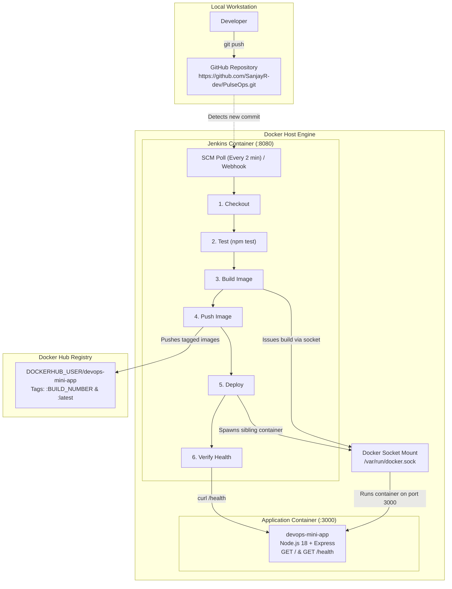

# PulseOps: Complete DevOps CI/CD Pipeline with Jenkins & Docker

PulseOps is an end-to-end automated Continuous Integration and Continuous Deployment (CI/CD) pipeline built with **Jenkins**, **Docker**, **Node.js**, and **GitHub**. It automates testing, container image creation, artifact registry publishing, and production deployment using the Docker-out-of-Docker (DooD) sibling container pattern.

---

## 1. Architecture Diagram



### Component Overview
- **GitHub Repository (`https://github.com/SanjayR-dev/PulseOps.git`)**: Central source code repository storing app code, Dockerfile, and Jenkinsfile.
- **Custom Jenkins Container**: Pre-packaged with Docker CLI, Node.js 18, and root access to `/var/run/docker.sock`. Orchestrates the entire pipeline on port `8080`.
- **Docker-out-of-Docker (Sibling Container Pattern)**: By mounting the host's `/var/run/docker.sock`, Jenkins starts containers side-by-side with itself on the host, avoiding the file system conflicts of Docker-in-Docker.
- **Docker Hub (`DOCKERHUB_USER/devops-mini-app`)**: Central image repository storing versioned image tags (`:<BUILD_NUMBER>`) and the moving pointer (`:latest`).
- **Application Container (`devops-mini-app`)**: Production container running Node.js 18 Alpine, exposing port `3000`, equipped with an automated Docker `HEALTHCHECK`.

---

## 2. Prerequisites

Ensure the following tools and accounts are ready before starting:

1. **Docker Desktop / Docker Engine**:
   - Installed and running.
   - On Windows: Ensure WSL2 backend or Hyper-V is running and Docker Desktop is started.
2. **Docker Hub Account**:
   - Account username (`DOCKERHUB_USER`).
   - Personal Access Token created under `Account Settings -> Security -> New Access Token` (read/write permissions).
3. **GitHub Account & Repository**:
   - Configured repository: `https://github.com/SanjayR-dev/PulseOps.git`.
4. **Git CLI & Node.js 18+** (for local testing).

---

## 3. Step-by-Step Setup Guide

### Step 3.1: Connect and Push to GitHub
Link this repository to your GitHub account:
```bash
git remote add origin https://github.com/SanjayR-dev/PulseOps.git
git push -u origin main
```

---

### Step 3.2: Update Placeholders
Open `Jenkinsfile` and replace the placeholder `DOCKERHUB_USER` with your real Docker Hub username:
```groovy
environment {
    IMAGE = 'DOCKERHUB_USER/devops-mini-app'
    CREDS = credentials('dockerhub-creds')
}
```
Commit and push the update to GitHub:
```bash
git add Jenkinsfile
git commit -m "chore: configure Docker Hub username"
git push
```

---

### Step 3.3: Build & Launch Jenkins
Navigate to the `jenkins/` directory and launch the customized Jenkins service:

```bash
cd jenkins
docker compose up -d --build
```

Verify that Jenkins is healthy and running:
```bash
docker ps
```
You should see `jenkins` listening on ports `0.0.0.0:8080->8080/tcp` and `0.0.0.0:50000->50000/tcp`.

---

### Step 3.4: Unlock Jenkins
Retrieve the auto-generated initial administrator password:

```bash
docker exec jenkins cat /var/jenkins_home/secrets/initialAdminPassword
```

1. Open your browser and navigate to: `http://localhost:8080`.
2. Paste the retrieved administrator password and click **Continue**.
3. Select **Install suggested plugins**.

---

### Step 3.5: Install Required Plugins
Once the initial plugins finish installing:
1. Navigate to **Manage Jenkins** -> **Plugins** -> **Available plugins**.
2. Search for and install the following plugins if not already installed:
   - **Git**
   - **Pipeline**
   - **Docker Pipeline**
   - **GitHub**
3. Check the box to restart Jenkins once installation completes, or manually restart the container if prompted.

---

### Step 3.6: Add Docker Hub Credentials
1. Go to **Manage Jenkins** -> **Credentials** -> **System** -> **Global credentials (unrestricted)**.
2. Click **+ Add Credentials**.
3. Fill in the following exact fields:
   - **Kind**: `Username with password`
   - **Scope**: `Global (Jenkins, nodes, items, all child items, etc)`
   - **Username**: Enter your `DOCKERHUB_USER`.
   - **Password**: Enter your Docker Hub Personal Access Token (or password).
   - **ID**: `dockerhub-creds` *(must match Jenkinsfile exactly)*.
   - **Description**: `Docker Hub Credentials`
4. Click **Create**.

---

### Step 3.7: Create the Pipeline Job
1. From the Jenkins dashboard, click **New Item**.
2. Enter the item name: `devops-mini-pipeline`.
3. Select **Pipeline** and click **OK**.
4. In the configuration page, scroll down to the **Pipeline** section:
   - **Definition**: Select `Pipeline script from SCM`.
   - **SCM**: Select `Git`.
   - **Repository URL**: Paste `https://github.com/SanjayR-dev/PulseOps.git`.
   - **Credentials**: Select your GitHub credentials if repository is private; leave as `- none -` if public.
   - **Branch Specifier**: `*/main` (or `*/master` matching your GitHub default branch).
   - **Script Path**: `Jenkinsfile`.
5. Under **Build Triggers**, verify that **Poll SCM** is checked with schedule:
   ```
   H/2 * * * *
   ```
6. Click **Save**.

---

## 4. Triggering a Build & Verifying Success

### Manual Trigger
1. On the `devops-mini-pipeline` project page, click **Build Now**.
2. Under **Build History**, click `#1` and open **Console Output**.

### Automated Trigger (Poll SCM)
1. Make a small code change in `app/server.js` (for example, update a log or greeting).
2. Commit and push to GitHub:
   ```bash
   git add app/server.js
   git commit -m "feat: trigger automated pipeline build"
   git push
   ```
3. Wait up to 2 minutes. Jenkins will detect the commit, trigger a new build, and run all 6 stages.

### What Success Looks Like:
1. **Pipeline Execution**: All 6 stages show green checkmarks:
   - Stage 1: `Checkout`
   - Stage 2: `Test` (passes `health.test.js`)
   - Stage 3: `Build image` (creates `DOCKERHUB_USER/devops-mini-app:<BUILD_NUMBER>` and `:latest`)
   - Stage 4: `Push image` (pushes both tags to Docker Hub)
   - Stage 5: `Deploy` (spawns container `devops-mini-app` on port 3000)
   - Stage 6: `Verify` (performs curl health check against `/health`)
2. **Accessing the Deployed Application**:
   - Open browser or terminal:
     ```bash
     curl http://localhost:3000
     ```
     **Response:**
     ```
     DevOps mini project: CI/CD with Jenkins and Docker (build #1)
     ```
   - Health check:
     ```bash
     curl http://localhost:3000/health
     ```
     **Response:**
     ```json
     {"status":"ok"}
     ```
3. **Docker Hub**:
   - Inspect your Docker Hub repository: tags `:1` (or respective build number) and `:latest` are visible.

---

## 5. Optional: Instant GitHub Webhooks with ngrok

To trigger pipeline builds instantly on push without waiting for the 2-minute polling interval:

1. Install and run [ngrok](https://ngrok.com/):
   ```bash
   ngrok http 8080
   ```
2. Copy the public HTTPS forwarding URL (e.g., `https://abcd-1234.ngrok-free.app`).
3. In your GitHub repository, go to **Settings** -> **Webhooks** -> **Add webhook**.
4. Configure the webhook:
   - **Payload URL**: `https://abcd-1234.ngrok-free.app/github-webhook/` *(trailing slash is required)*.
   - **Content type**: `application/json`.
   - **Which events would you like to trigger this webhook?**: `Just the push event`.
   - **Active**: Checked.
5. Click **Add webhook**. Subsequent Git pushes will trigger Jenkins builds instantly.

---

## 6. Troubleshooting Matrix

| Issue | Root Cause | Solution |
| :--- | :--- | :--- |
| **`docker: permission denied while trying to connect to the Docker daemon socket`** | Jenkins container is executing as non-root user without access to `/var/run/docker.sock`. | Ensure `jenkins/Dockerfile` specifies `USER root`. If mounting on Linux, execute `chmod 666 /var/run/docker.sock` on the host. |
| **`docker.sock: no such file or directory`** | The Docker socket path was not mounted or Docker Desktop is stopped. | Verify Docker Desktop is active. In `docker-compose.yml`, confirm `/var/run/docker.sock:/var/run/docker.sock` is listed under `volumes`. |
| **`port 8080 or 3000 already in use`** | A local process or previous container is holding port 8080 or 3000. | Check active ports: `netstat -ano \| findstr :8080` (Windows) or `lsof -i :8080` (macOS/Linux). Stop conflicting processes or remove existing containers via `docker rm -f <container_id>`. |
| **`host.docker.internal not resolving`** | Container DNS inside Jenkins cannot resolve the host IP. | The pipeline automatically falls back to the Docker gateway `172.17.0.1`. Additionally, `jenkins/docker-compose.yml` includes `extra_hosts: ["host.docker.internal:host-gateway"]` to guarantee host name resolution. |
| **`npm test fails during pipeline`** | Code defect or broken test assertion in `app/`. | Run `cd app && npm test` locally before pushing. Check console logs for Supertest/Jest failure details. |
| **`docker login fails: 401 Unauthorized`** | Invalid credentials in Jenkins. | Verify your Docker Hub credentials in Jenkins. Use an access token generated from Docker Hub rather than your raw account password. |

---

## 7. Two-Minute Demo Script

Follow this step-by-step walkthrough to present the project to interviewers or reviewers:

- **0:00 - 0:25 (Architecture & Setup)**:
  - *"Here is PulseOps, a fully automated CI/CD pipeline using Jenkins and Docker."*
  - Show `docs/architecture.md` and explain the sibling container architecture: Jenkins runs inside Docker on port 8080 and talks to `/var/run/docker.sock` to spin up sibling containers on port 3000.
  
- **0:25 - 0:50 (Source Code & Quality Gate)**:
  - Show `app/server.js` and `app/test/health.test.js`.
  - Explain the fail-fast quality gate: Jenkins runs `npm test` before building images, preventing defective code from touching production.
  
- **0:50 - 1:20 (The Pipeline in Action)**:
  - In `app/server.js`, modify the greeting text or make a minor change.
  - Run `git commit -am "chore: demo pipeline update" && git push`.
  - Switch to Jenkins UI (`http://localhost:8080`). Watch the pipeline trigger, execute through Checkout -> Test -> Build image -> Push image -> Deploy -> Verify.
  
- **1:20 - 1:45 (Registry & Deployment Verification)**:
  - Open Docker Hub in browser: show the newly uploaded image tag matching `$BUILD_NUMBER` and `:latest`.
  - Open terminal: execute `docker ps` to display `jenkins` (port 8080) and `devops-mini-app` (port 3000) running concurrently.
  
- **1:45 - 2:00 (Live Application Verification)**:
  - Visit `http://localhost:3000` to show the updated message with the live build number.
  - Visit `http://localhost:3000/health` to demonstrate the automated health check verification.
  - Wrap up: *"We have full CI/CD automation from git push to production health verification."*

