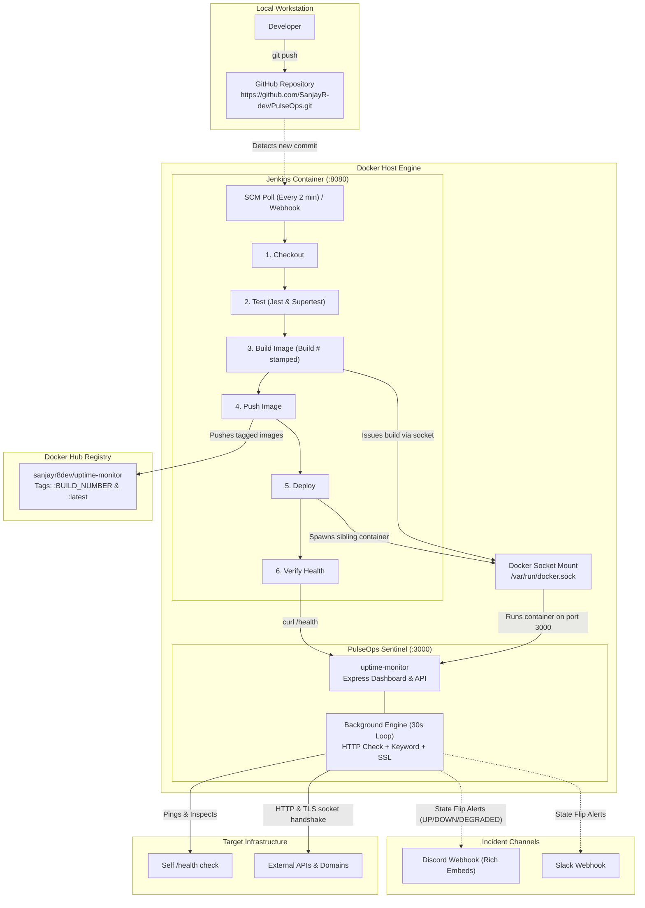

# PulseOps Sentinel: CI/CD Pipeline & Uptime/SSL Watchdog

PulseOps Sentinel is an end-to-end automated Continuous Integration and Continuous Deployment (CI/CD) pipeline built with **Jenkins**, **Docker**, **Node.js**, and **GitHub**. It packages and deploys a live **Uptime, Content Integrity & SSL Certificate Sentinel** that monitors target infrastructure and dispatches real-time incident alerts to Discord and Slack.

> **Pitch**: *"Every push is tested, containerized, and redeployed automatically, and the app it deploys alerts me on Discord when a service goes down, degrades, or has an expiring SSL certificate."*

---

## 1. Architecture Diagram



### Component Overview
- **GitHub Repository (`https://github.com/SanjayR-dev/PulseOps.git`)**: Central source code repository storing app code, Dockerfile, and Jenkinsfile.
- **Custom Jenkins Container**: Pre-packaged with Docker CLI, Node.js 18, and root access to `/var/run/docker.sock`. Orchestrates the entire pipeline on port `8080`.
- **Docker-out-of-Docker (Sibling Container Pattern)**: By mounting the host's `/var/run/docker.sock`, Jenkins starts containers side-by-side with itself on the host, avoiding the file system conflicts of Docker-in-Docker.
- **Docker Hub (`sanjayr8dev/uptime-monitor`)**: Central image repository storing versioned image tags (`:<BUILD_NUMBER>`) and the moving pointer (`:latest`).
- **PulseOps Sentinel Container (`uptime-monitor`)**: Production container running Node.js 18 Alpine, exposing port `3000`, equipped with an automated Docker `HEALTHCHECK`.
- **Background Inspection Engine**: Periodically executes HTTP requests, verifies response body keywords (silent failure prevention), inspects TLS socket certificates for expiration, and fires alerts only on state flips.

---

## 2. Prerequisites

Ensure the following tools and accounts are ready before starting:

1. **Docker Desktop / Docker Engine**:
   - Installed and running.
   - On Windows: Ensure WSL2 backend is active and Docker Desktop shows "Engine running".
2. **Docker Hub Account**:
   - Account username: `sanjayr8dev`.
   - Personal Access Token created under `Account Settings -> Security -> New Access Token` (read/write permissions).
3. **GitHub Account & Repository**:
   - Configured repository: `https://github.com/SanjayR-dev/PulseOps.git`.
4. **Discord Server or Slack Workspace** (Optional, for live alerts):
   - A channel with an incoming webhook URL.

---

## 3. Step-by-Step Setup Guide

### Step 3.1: Connect and Push to GitHub
Link this repository to your GitHub account:
```bash
git remote add origin https://github.com/SanjayR-dev/PulseOps.git
git push -u origin main
```

---

### Step 3.2: Build & Launch Jenkins
Navigate to the `jenkins/` directory and launch the customized Jenkins service:

```bash
cd jenkins
docker compose up -d --build
```

Verify that Jenkins is healthy and running:
```bash
docker ps
```
You should see `jenkins` listening on ports `0.0.0.0:8080->8080/tcp` and `0.0.0.0:50000->50000/tcp`.

---

### Step 3.3: Unlock Jenkins
Retrieve the auto-generated initial administrator password:

```bash
docker exec jenkins cat /var/jenkins_home/secrets/initialAdminPassword
```

1. Open your browser and navigate to: `http://localhost:8080`.
2. Paste the retrieved administrator password and click **Continue**.
3. Select **Install suggested plugins**.

---

### Step 3.4: Install Required Plugins
1. Open the top right **Gear icon ⚙️** (Manage Jenkins) -> **Plugins** -> **Available plugins**.
2. Search for and install:
   - **Docker Pipeline** *(Git and Pipeline are installed by default)*.
   - **GitHub**
3. Restart Jenkins if prompted.

---

### Step 3.5: Add Credentials in Jenkins

#### A. Docker Hub Credentials (Required)
1. Go to: `http://localhost:8080/manage/credentials/store/system/domain/_/`
2. Click **+ Add Credentials**:
   - **Kind**: `Username with password`
   - **Scope**: `Global`
   - **Username**: `sanjayr8dev`
   - **Password**: *(Paste your Docker Hub Personal Access Token)*
   - **ID**: `dockerhub-creds` *(must match exactly)*
   - **Description**: `Docker Hub Credentials`
3. Click **Create**.

#### B. Discord / Slack Webhook URL (Optional, for live alerts)
1. In the same credentials page, click **+ Add Credentials**:
   - **Kind**: `Secret text`
   - **Scope**: `Global`
   - **Secret**: *(Paste your Discord or Slack webhook URL)*
   - **ID**: `alert-webhook-url` *(must match exactly)*
   - **Description**: `Incident Alert Webhook URL`
2. Click **Create**.

---

### Step 3.6: Create the Pipeline Job
1. From the Jenkins dashboard, click **+ New Item** (or *Create a job*).
2. Enter the item name: `pulseops-pipeline`.
3. Select **Pipeline** and click **OK**.
4. In the configuration page, scroll down to the **Pipeline** section:
   - **Definition**: Select `Pipeline script from SCM`.
   - **SCM**: Select `Git`.
   - **Repository URL**: `https://github.com/SanjayR-dev/PulseOps.git`.
   - **Branch Specifier**: `*/main`.
   - **Script Path**: `Jenkinsfile`.
5. Under **Build Triggers**, check **Poll SCM** with schedule:
   ```text
   H/2 * * * *
   ```
6. Click **Save**.

---

## 4. Triggering a Build & Verifying Success

### Manual Trigger
1. On the `pulseops-pipeline` project page, click **Build Now**.
2. Under **Build History**, click the latest build number (e.g. `#1`) and open **Console Output**.

### Automated Trigger (Poll SCM)
1. Make a small code change or add a commit.
2. Commit and push to GitHub:
   ```bash
   git commit --allow-empty -m "feat: trigger automated pipeline build"
   git push origin main
   ```
3. Within 2 minutes, Jenkins automatically kicks off the build.

### What Success Looks Like:
1. **Pipeline Execution**: All 6 stages show green checkmarks:
   - Stage 1: `Checkout`
   - Stage 2: `Test` (passes Jest API, validation & mock alert tests)
   - Stage 3: `Build image` (creates `sanjayr8dev/uptime-monitor:<BUILD_NUMBER>` and `:latest`)
   - Stage 4: `Push image` (pushes both tags to Docker Hub)
   - Stage 5: `Deploy` (spawns container `uptime-monitor` on port 3000 with optional `ALERT_WEBHOOK_URL`)
   - Stage 6: `Verify` (performs curl health check against `/health`)
2. **Accessing the Live Application**:
   - Open browser: `http://localhost:3000`.
   - The PulseOps Sentinel dashboard loads with live metrics, response time, SSL pills, and the footer stamped with your Jenkins build number (e.g. `Build #1`).

---

## 5. Setting Up Discord or Slack Alerts

### Setting up a Discord Webhook (Takes 60 seconds):
1. In Discord, create a new server (or select an existing one).
2. Right-click your channel (e.g. `#alerts`) -> **Edit Channel** (Gear icon).
3. Click **Integrations** -> **Webhooks** -> **New Webhook**.
4. Name it `PulseOps Sentinel` and click **Copy Webhook URL**.
5. Add this URL to Jenkins as a `Secret text` credential with the ID **`alert-webhook-url`** (see Step 3.5 B).

---

## 6. Optional: Instant GitHub Webhooks with ngrok

To trigger pipeline builds instantly on push without waiting for the 2-minute polling interval:

1. Install and run [ngrok](https://ngrok.com/):
   ```bash
   ngrok http 8080
   ```
2. Copy the public HTTPS forwarding URL (e.g., `https://abcd-1234.ngrok-free.app`).
3. In your GitHub repository, go to **Settings** -> **Webhooks** -> **Add webhook**.
4. Configure the webhook:
   - **Payload URL**: `https://abcd-1234.ngrok-free.app/github-webhook/` *(trailing slash is required)*.
   - **Content type**: `application/json`.
   - **Which events would you like to trigger this webhook?**: `Just the push event`.
   - **Active**: Checked.
5. Click **Add webhook**.

---

## 7. Troubleshooting Matrix

| Issue | Root Cause | Solution |
| :--- | :--- | :--- |
| **`docker: permission denied while connecting to docker daemon socket`** | Jenkins container is executing as non-root user without access to `/var/run/docker.sock`. | Ensure `jenkins/Dockerfile` specifies `USER root`. If mounting on Linux, execute `chmod 666 /var/run/docker.sock` on the host. |
| **`docker.sock: no such file or directory`** | The Docker socket path was not mounted or Docker Desktop is stopped. | Verify Docker Desktop is active. In `jenkins/docker-compose.yml`, confirm `/var/run/docker.sock:/var/run/docker.sock` is listed under `volumes`. |
| **`port 8080 or 3000 already in use`** | A local process or previous container is holding port 8080 or 3000. | Check active ports: `netstat -ano \| findstr :8080` (Windows) or `lsof -i :8080` (macOS/Linux). Stop conflicting processes or remove existing containers via `docker rm -f <container_id>`. |
| **`host.docker.internal not resolving`** | Container DNS inside Jenkins cannot resolve the host IP. | The pipeline automatically falls back to the Docker gateway `172.17.0.1`. Additionally, `jenkins/docker-compose.yml` includes `extra_hosts: ["host.docker.internal:host-gateway"]` to guarantee host name resolution. |
| **`npm test fails during pipeline`** | Code defect or broken test assertion in `app/`. | Run `cd app && npm test` locally before pushing. Check console logs for Jest failure details. |
| **`docker login fails: 401 Unauthorized`** | Invalid credentials in Jenkins. | Verify your Docker Hub credentials in Jenkins. Ensure you use an access token generated from Docker Hub rather than your raw account password. |

---

## 8. Two-Minute Demo Script

Follow this step-by-step walkthrough to present the project to interviewers or reviewers:

- **0:00 - 0:30 (Architecture & Pipeline)**:
  - *"Here is PulseOps Sentinel, a complete DevOps CI/CD pipeline deploying a live Synthetic Uptime, Content Integrity & SSL Watchdog."*
  - Show `docs/architecture.md` and explain the sibling container architecture: Jenkins runs inside Docker on port 8080 and mounts `/var/run/docker.sock` to orchestrate builds directly on the host.

- **0:30 - 1:00 (Live Dashboard Tour)**:
  - Open `http://localhost:3000`.
  - Point out the summary cards (Total Targets, UP, DEGRADED, DOWN, Avg Latency).
  - Point out the SSL pill (`🔒 142d left`) and the 20-check mini history sparklines.
  - Point out the footer showing the active Jenkins build stamp: `Build #<BUILD_NUMBER>`.

- **1:00 - 1:30 (Simulate Live Outage & Discord Alert)**:
  - In the "Interview Demo Outage Simulator" banner, click **+ Add Mock Target**.
  - Show it appearing in the table with green status.
  - Click **⚡ Toggle Crash / Recover**.
  - Click **⚡ Ping** on the row: the status immediately flips to **🔴 DOWN**.
  - Switch to your Discord channel: show the live red alert card arriving with error details!
  - Click **⚡ Toggle Crash / Recover** again, ping, and show the green recovery alert arriving.

- **1:30 - 2:00 (End-to-End CI/CD Demo)**:
  - Make a small UI change in `app/public/index.html` (e.g. change an icon or title).
  - Run `git commit -am "feat: update dashboard header" && git push origin main`.
  - Switch to Jenkins UI (`http://localhost:8080/job/pulseops-pipeline`): watch the pipeline automatically trigger, test, build, push to Docker Hub, and redeploy.
  - Refresh `http://localhost:3000` to show the updated build number in the footer.
  - Wrap up: *"We have full CI/CD automation from git push to production health verification and live incident alerting."*
