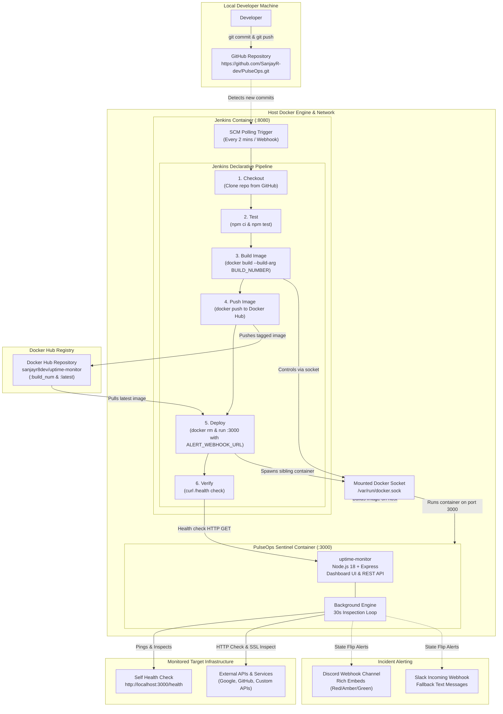

# PulseOps Sentinel Architecture Documentation

## Overview

PulseOps Sentinel implements an end-to-end automated Continuous Integration and Continuous Deployment (CI/CD) pipeline deploying a real-time **Uptime, Content Integrity & SSL Certificate Sentinel** using **Jenkins**, **Docker**, **Node.js**, and **GitHub**.

The architecture employs the **Docker-out-of-Docker (DooD) / Sibling Container** pattern via `/var/run/docker.sock`, allowing the containerized Jenkins controller to orchestrate container builds and deployments directly on the host Docker daemon.

---

## Architectural Workflow (Mermaid Diagram)

---

## Component Deep Dive

### 1. Developer & Source Control (GitHub)
- **Role**: Developers push application source code, Docker configuration, and pipeline specifications to GitHub.
- **Trigger**: Jenkins is configured with `pollSCM('H/2 * * * *')`, automatically polling the remote Git repository every 2 minutes for changes.

### 2. Jenkins Controller (Custom Docker Container)
- **Role**: CI/CD automation engine orchestrating tests, builds, and releases.
- **Port**: Exposed to the host at port `8080` (Web UI) and `50000` (build agent communication).
- **Customization**: Runs from a custom `Dockerfile` based on `jenkins/jenkins:lts-jdk17`. Unlike standard Jenkins images, it includes:
  - Docker CLI (`docker-ce-cli`) to issue Docker commands.
  - Node.js 18 and npm to execute testing scripts inside pipeline stages.
  - Configured to execute as `root` so it can communicate with `/var/run/docker.sock` without permission denial errors.
- **Data Persistence**: Mounts a Docker named volume (`jenkins_home`) to `/var/jenkins_home`, persisting pipeline configs, build logs, and credentials across container restarts.

### 3. Docker-out-of-Docker (Sibling Containers via `docker.sock`)
- **Mechanism**: The host socket `/var/run/docker.sock` is bind-mounted directly into the Jenkins container.
- **Benefit**: Rather than running Docker *inside* Docker (DinD)—which causes file system performance degradation and storage driver conflicts—the Jenkins container uses the host's Docker daemon. When Jenkins issues `docker run`, the target container runs as a sibling alongside Jenkins directly on the host operating system.

### 4. Docker Hub Registry
- **Role**: Centralized container artifact repository.
- **Security**: Authenticated using Jenkins credentials (`dockerhub-creds`), storing the username and Personal Access Token securely. The credentials are provided to the pipeline via masked environment variables (`$CREDS_USR`, `$CREDS_PSW`) without committing secrets or writing tokens to repository files.
- **Tagging Strategy**: Builds produce two tags for every successful run:
  - `sanjayr8dev/uptime-monitor:<BUILD_NUMBER>`: Immutable, versioned build artifact.
  - `sanjayr8dev/uptime-monitor:latest`: Moving pointer to the current stable build.

### 5. Application Container (`uptime-monitor`)
- **Base Image**: `node:18-alpine` for minimal attack surface and lightweight footprint (< 120MB).
- **Port**: Host port `3000` mapped to container port `3000`.
- **Capabilities**:
  - **Uptime Monitoring**: Pings target services on an automated 30s background cycle with a 5s timeout.
  - **Content & Silent Failure Verification**: Validates expected response keywords in the response body to detect silent 200 OK application crashes.
  - **SSL Certificate Sentinel**: Inspects TLS socket handshake certificates, extracting issuer and calculating days until expiration.
  - **Real-Time Web Dashboard**: Displays live operational metrics, response latency, 20-check history sparklines, and a manual demo outage simulator.
- **Resilience**: Configured with `--restart unless-stopped` and Docker's native `HEALTHCHECK` directive hitting `/health`.

### 6. Incident Webhook Alerting
- **Mechanism**: Reads `ALERT_WEBHOOK_URL` injected by Jenkins from an optional credential (`alert-webhook-url`).
- **State-Flip Only**: Alerts are dispatched strictly on state changes (`UP -> DOWN`, `UP -> DEGRADED`, `DOWN -> UP`) and critical SSL expiration thresholds (<= 14 days), preventing notification fatigue.
- **Compatibility**: JSON payload includes `text` (Slack), `content` (Discord), and rich Discord embed cards (Red for DOWN, Amber for DEGRADED, Green for RECOVERED).
