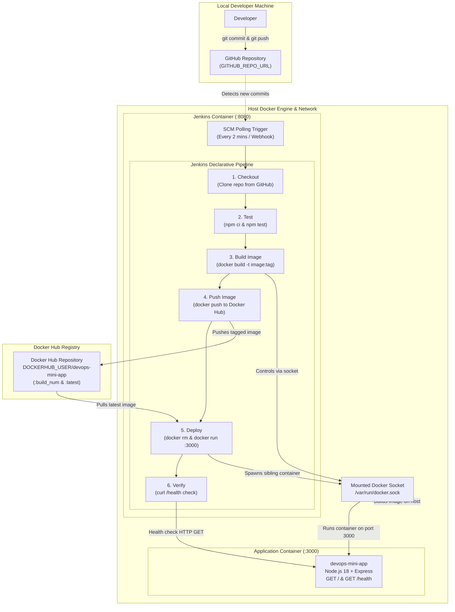

# PulseOps Architecture Documentation

## Overview

PulseOps implements an end-to-end automated Continuous Integration and Continuous Deployment (CI/CD) pipeline using **Jenkins**, **Docker**, and **GitHub**. The architecture employs the **Docker-out-of-Docker (DooD) / Sibling Container** pattern via `/var/run/docker.sock`, allowing the containerized Jenkins controller to orchestrate container builds and deployments directly on the host Docker daemon.

---

## Architectural Workflow (Mermaid Diagram)

---

## Component Deep Dive

### 1. Developer & Source Control (GitHub)
- **Role**: Developers push application source code, Docker configuration, and pipeline specifications to GitHub.
- **Trigger**: Jenkins is configured with `pollSCM('H/2 * * * *')`, automatically polling the remote Git repository every 2 minutes for changes. Optionally, an ngrok-exposed webhook can be configured for instant event-driven execution.

### 2. Jenkins Controller (Custom Docker Container)
- **Role**: CI/CD automation engine orchestrating tests, builds, and releases.
- **Port**: Exposed to the host at port `8080` (Web UI) and `50000` (build agent communication).
- **Customization**: Runs from a custom `Dockerfile` based on `jenkins/jenkins:lts-jdk17`. Unlike standard Jenkins images, it includes:
  - Docker CLI (`docker-ce-cli`) to issue Docker commands.
  - Node.js 18 and npm to execute testing scripts inside pipeline stages.
  - Configured to execute as `root` so it can communicate with `/var/run/docker.sock` without permission denial errors.
- **Data Persistence**: Mounts a Docker named volume (`jenkins_home`) to `/var/jenkins_home`, persisting pipeline configs, build logs, and credentials across container restarts.

### 3. Docker-out-of-Docker (Sibling Containers via `docker.sock`)
- **Mechanism**: The host socket `/var/run/docker.sock` is bind-mounted directly into the Jenkins container.
- **Why Sibling Containers?**: Rather than running Docker *inside* Docker (DinD)—which causes file system performance degradation and storage driver conflicts—the Jenkins container uses the host's Docker daemon. When Jenkins issues `docker run`, the target container runs as a sibling alongside Jenkins directly on the host operating system.

### 4. Docker Hub Registry
- **Role**: Centralized container artifact repository.
- **Security**: Authenticated using Jenkins credentials (`dockerhub-creds`), storing the username and Personal Access Token securely. The credentials are provided to the pipeline via masked environment variables (`$CREDS_USR`, `$CREDS_PSW`) without committing secrets or writing tokens to repository files.
- **Tagging Strategy**: Builds produce two tags for every successful run:
  - `DOCKERHUB_USER/devops-mini-app:<BUILD_NUMBER>`: Immutable, versioned build artifact.
  - `DOCKERHUB_USER/devops-mini-app:latest`: Moving pointer to the current stable build.

### 5. Application Container (`devops-mini-app`)
- **Base Image**: `node:18-alpine` for minimal attack surface and lightweight footprint (< 120MB).
- **Port**: Host port `3000` mapped to container port `3000`.
- **Endpoints**:
  - `GET /`: Returns project identity and active build identifier (`DevOps mini project: CI/CD with Jenkins and Docker (build #<BUILD_NUMBER>)`).
  - `GET /health`: JSON status endpoint (`{"status":"ok"}`) with HTTP 200.
- **Resilience**: Configured with `--restart unless-stopped` and Docker's native `HEALTHCHECK` directive.

### 6. Automated Health Verification Stage
- **Role**: Immediate post-deployment verification.
- **Resolution Strategy**:
  1. Requests `http://host.docker.internal:3000/health` (standard Docker bridge-to-host DNS route).
  2. If DNS fails or host network restrictions block `host.docker.internal`, it automatically falls back to Docker bridge gateway `http://172.17.0.1:3000/health`.
  3. Halts the build and marks the deployment as failed if HTTP 200 is not received within the timeout window.
